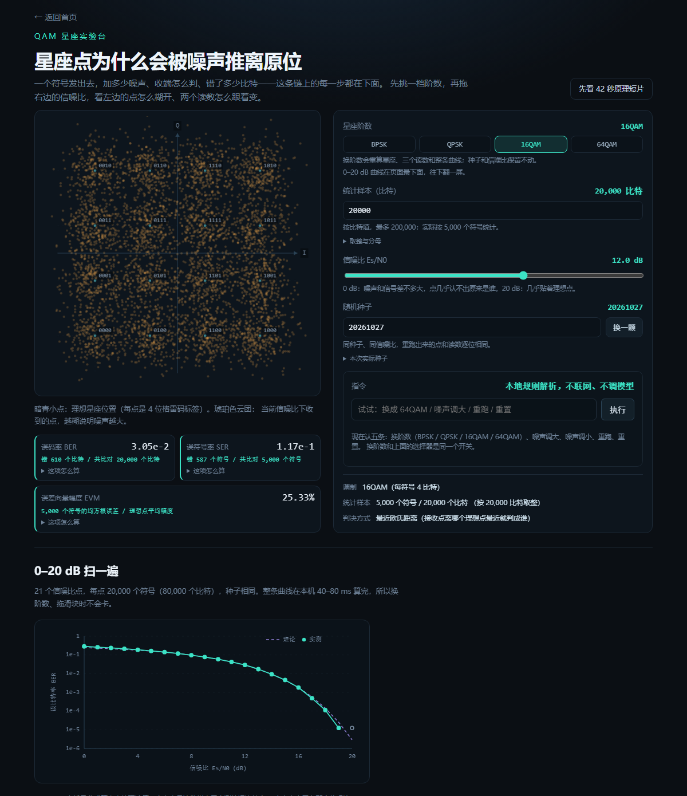
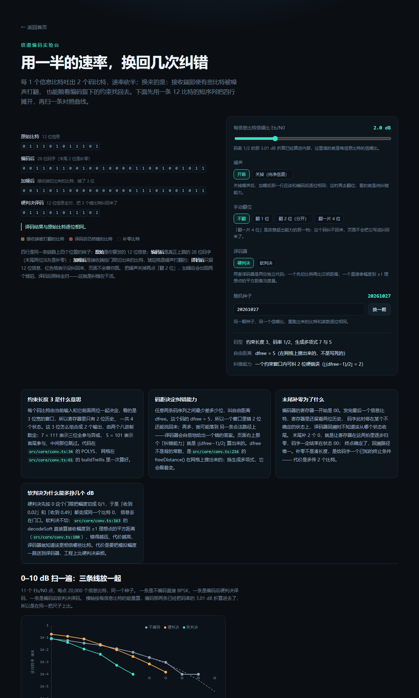
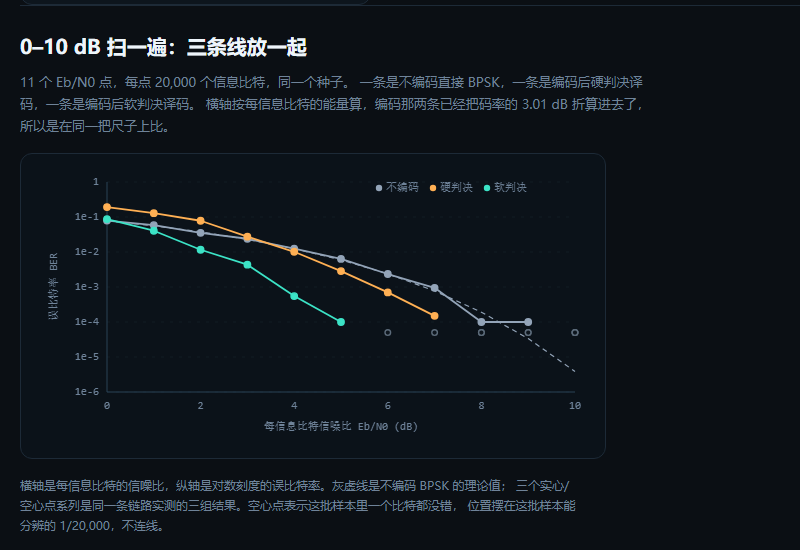

# 通信原理交互实验室

一个在浏览器里跑的小实验室：把通信原理课上那几条公式变成能拖的图。不用装 MATLAB，不用配环境，打开网页就能看星座点怎么被噪声推散、卷积码怎么把打翻的比特纠回来。

**在线地址：** https://240000000.github.io/comm-lab/

**本文件对应仓库 tag `R7`**，仓库地址：https://github.com/240000000/comm-lab —— 想对着看代码的话，`git show R7` 能看到这一版对应的全部改动。

---

## 一、这个项目是干什么的

我在通信原理课上背了一学期的公式——QAM 星座图长什么样、误码率随信噪比怎么走、卷积码为什么能纠错——全是符号。考试换个信噪比，我就得从头推一遍，还推不对。真正的问题不是不会算，是看不见：星座点被噪声推离原位是什么样子、一帧比特里哪几位被打翻、译码器凭什么说这几位是错的，这些在纸上都没法画。

所以我把它们做成了网页上的两个实验台。拖一下信噪比滑块，16 个星座点立刻变成 16 团云；翻两个比特，看译码器把它们全纠回来；翻四位，它纠不回来，页面就照实写「还有 3 位没纠回来」，不替我圆。

## 二、怎么用

1. 打开 https://240000000.github.io/comm-lab/ 。首页是四张卡片，现在能点的是前两张。
2. 点第一张「QAM 星座实验台」。左边是星座图，右边是控件。
3. 把右边的「信噪比 Es/N0」滑块从 20 dB 往左拖。20 dB 时 EVM 约 10%，点基本贴着理想位置；拖到 12 dB，每个点变成一小团；拖到 0 dB，整片都是琥珀色的散点，已经分不出原来那个点在哪。
4. 看下面三个读数：误码率、误符号率、误差向量幅度。每个数字后面都写着它是由多少个符号、多少个比特算出来的——0 dB 时误码率是 2.86e-1，括号里是「错 22,916 个比特 / 共比对 80,000 个比特」。
5. 再往下是 0–20 dB 的误码率曲线，灰色虚线是公式算的理论值，实心点是这批样本实测的。
6. 回到首页，点第二张「卷积码与 Viterbi」。上面是一条 12 比特短序列的四行：原始、编码后、加噪后、译码后。琥珀色格子是接收端被打翻的比特，红色格子是译码后还错的。
7. 右边点「关掉」噪声，加噪后那行会和编码后完全一样；再点「翻 2 位」，加噪后出现两个琥珀格，译码后照样全对。换成「翻一片 4 位」，这次它纠不回来，页面会写还剩几位没纠回。
8. 中间可以切「硬判决 / 软判决」两套译码器，下面的三条线是同一批信噪比下不编码、硬判决、软判决的误码率对照。

## 三、现在做到哪一步

- **QAM 星座实验台：能玩。** 阶数写死 16QAM（暂不支持切换 QAM 阶数），可调的是信噪比 0–20 dB；读数、点云、0–20 dB 误码率曲线都在。
- **卷积码与 Viterbi：能玩。** 约束长度 3、码率 1/2、生成多项式 7 和 5，硬判决与软判决两套独立译码器，12 比特短序列四行对照，0–10 dB 三条线对照曲线。
- **OFDM 时频链路：还没开始。**
- **任务模式：还没开始。**

版本 `v0.5`。测试 68 条，全部用 Node 自带的 test runner 跑，没有引入任何测试框架。

## 四、亮点

对我来说最有用的一点：它把「看不见」变成「看得见」，而且数字不肯含糊。

- 每个读数都带分母。误码率不是孤零零一个 2.9e-2，而是「2,331 / 80,000」。样本不够的时候它不装懂——20 dB 那个点上实测是 0 个比特出错，页面写的是「这次没出错，0 / 80,000」，曲线上画成空心圈，因为这一批样本能分辨的最小误码率就是 1/80,000，再低就看不见了，不是真的零。
- 同一个种子重跑，数字一模一样。界面上写着这次实际用的种子，可以自己填。
- 不对劲的地方照实标出来。卷积码那一页，0–2 dB 一段硬判决的误码率比不编码还高，这不是 bug：码率 1/2 让每个信息比特只分到一半能量，硬判决又把幅度信息全扔了，低信噪比就先付这笔账。图注里就这么写的。

## 五、AI 是怎么参与进来的

这个项目是我和 AI 一轮一轮做出来的，每轮结束把当轮对话原文存进仓库（`docs/dialogues/`），一个 commit、一个 tag。它不是我描述需求、它一次生成的。挑几件具体的说：

- **第一轮我让它先别写代码，先给判据。** 它预测「还没有测试文件时 `npm test` 会失败」，实际跑出来是 0 个测试、退出码 0。它当场承认判据写错了，把判据改成「测试数必须不少于 21 条、fail 为 0」才动手。
- **它写的对话存档被我抓出不是原话。** 它按自己的回放抄了四句，和屏幕上差着措辞。我要求：存档必须是复制粘贴的原话，拿不到就标「原文缺失」，不许重写；而且不许 amend 旧提交，单开一个 fix 提交改回来，让「我发现自己没逐字」这件事留在历史里。从那轮起改成先写进存档、再从存档复制进回复。
- **有一轮它差点把占位符当原文收下。** 我说原文贴了，实际正文里只有一行模板占位。它没有照抄，而是指出来「这不是原文」，让我重贴。这个判断是对的。
- **首页那句「能调 QAM 阶数」是它写的，但阶数其实写死 16。** 我在提交前逐句核对时抓到了，要求改成只写现在真能做到的，或者把阶数切换做出来。这轮选了改文案——功能等十一月再加。
- **图注压住横轴刻度、点云透明度太糊看不清标签，都是我截图后挑出来的。** 它改完我再截一遍确认。
- **它想偷懒的地方我自己立了规矩**：某个信噪比下一条错都没有时，不许写 1e-5 糊弄，要么写「这次没出错，0/n」，要么直说样本不够。曲线上样本不够的地方画空心，不许硬连。

这些都是我抓着改的。它写得快，但「写得像真的」和「真的」不是一回事，这个项目里每一轮都得我自己去核。

## 六、关键技术

- **纯前端。** Vite + React + TypeScript，没有后端、没有数据库、运行时不调任何模型接口，也不需要任何密钥。所有计算在浏览器里完成，静态托管在 GitHub Pages 上。
- **算法全部自己写，不引通信库。** 星座映射与格雷码、AWGN 加噪与最近距离判决、误码率理论曲线（erfc/Q 函数的数值拟合）、卷积码网格与编码、硬判决与软判决两套 Viterbi、自由距离搜索——都是仓库里 `src/core/` 下的纯函数，评委可以直接读。
- **随机数可复现。** 用 mulberry32 生成均匀分布，Box–Muller 转成高斯噪声。每次仿真用 `种子 + 信噪比` 派生出这一次真正用的种子，并显示在界面上；同一个种子、同一个信噪比，重跑出来的点和读数逐位相同。
- **软判决和硬判决差在哪。** 硬判决先把接收幅度按 0 门限切成比特，再比汉明距离——「收到 0.02」和「收到 0.49」都变成同一个 0，离门限多远这层信息就丢了。软判决不切，直接拿接收幅度到 ±1 理想点的平方距离当分支度量，越远的候选代价越高。同一批参数下（11 个信噪比点、每点 20,000 个比特、同一种子），4 dB 时硬判决错 203 个比特、软判决错 11 个；差的这截就是上面被丢掉的那层信息换来的。
- **码距是搜出来的。** 约束长度 3、生成多项式 7 和 5 这组码，自由距离 dfree = 5 是程序在网格上搜出来的，纠错能力 = ⌊(5−1)/2⌋ = 2 位，页面上写明「一个约束窗口内」。
- **性能。** QAM 那条 21 点 × 20,000 符号的曲线，本机约 60 ms 扫完；卷积码 11 点 × 20,000 比特的三条线约 178 ms。单次 20,000 个符号的仿真约 6 ms，所以拖滑块时不会卡。

## 七、截图

12 dB 下的 16QAM：16 团云分得开，4 位格雷码标签还读得清。

卷积码页的四行对照：琥珀格是被打翻的比特，译码后全纠回来。

三条线：不编码、硬判决、软判决。空心圈表示那个信噪比下一个比特都没错，不是真的零。

## 八、发表与获奖

没有。这是课程学习里长出来的一个作品，没有发表论文，也没有获奖记录。

## 九、是否基于别人的项目

没有。代码从空仓库开始，一行一行写的；算法照课本的公式自己实现，没有用现成的通信仿真库，也没有拿别人的项目改。参考的只有教材里的公式和公开的误码率理论式。
