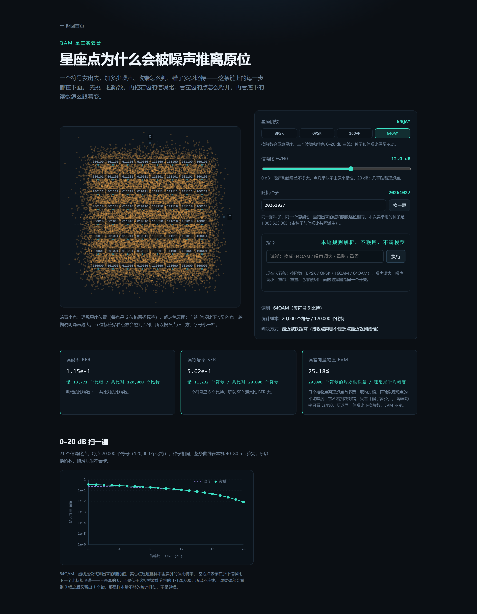
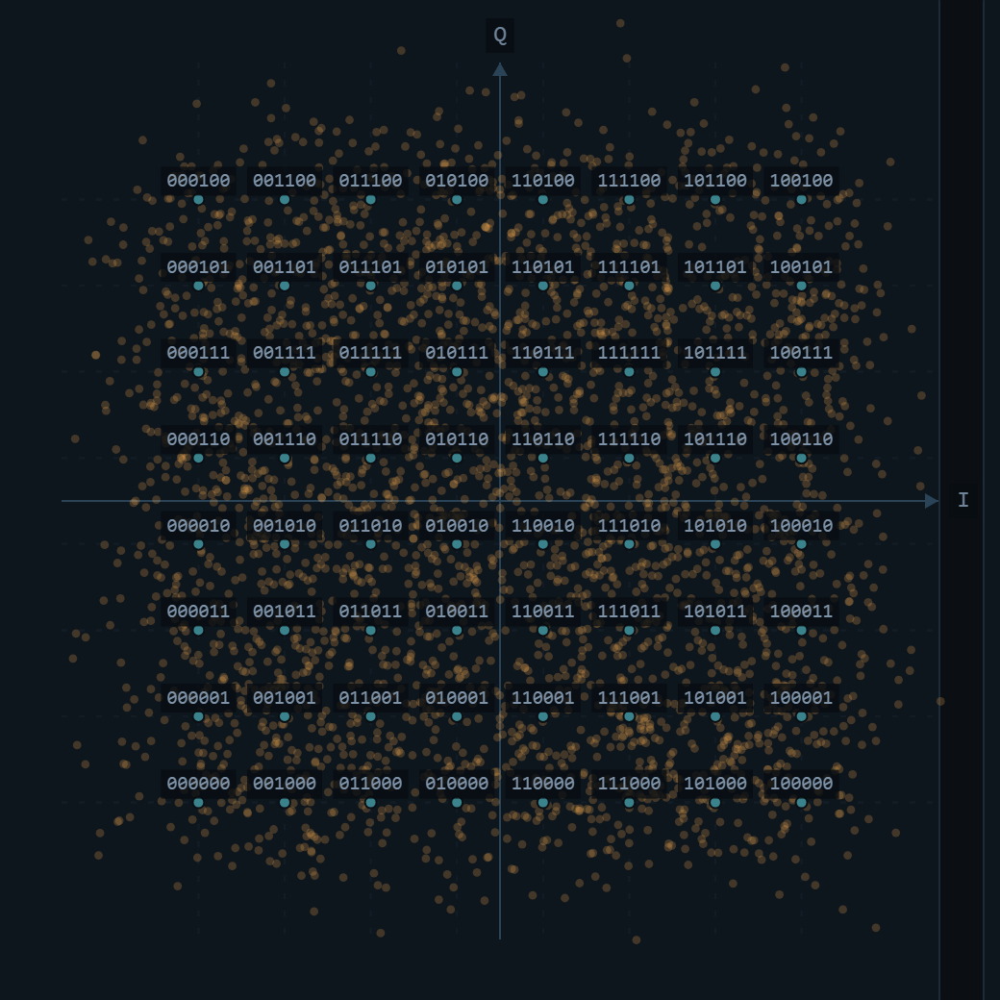
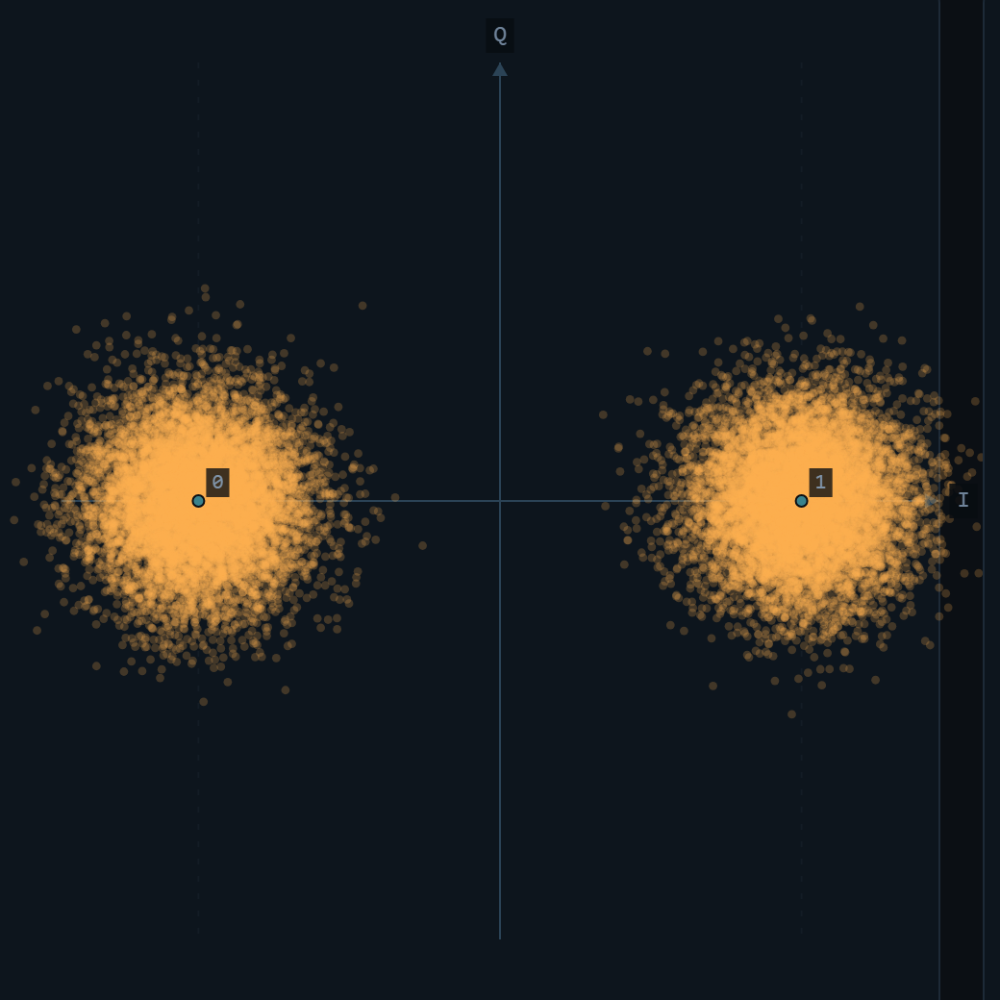

# 通信原理交互实验室

一个在浏览器里跑的小实验室。它把通信原理课上那几条公式变成能拖的图。不用装 MATLAB，不用配环境。打开网页，就能看星座点怎么被噪声推散，卷积码怎么把打翻的比特纠回来。

在线地址：https://240000000.github.io/comm-lab/

本文件对应仓库提交 0f1646d（tag R23 之后的文字校订），仓库地址：https://github.com/240000000/comm-lab。想对着看代码，`git show 0f1646d` 能看到这一版的全部改动。

---

## 一、这个项目是干什么的

通信原理课上，我背了一学期公式。QAM 星座长什么样，误码率随信噪比怎么走，卷积码为什么能纠错，全是符号。考试换个信噪比，我就得从头推，还推不对。问题不在于不会算，而在于看不见。星座点被噪声推离原位是什么样，一帧比特里哪几位被打翻，译码器凭什么说这几位错了，这些在纸上都画不出来。

所以我把它们做成三个网页实验台。拖一下信噪比，十六个点立刻变成十六团云。翻两位，译码器把它们全纠回来。翻四位，它纠不回来，页面就照实写「还有 1 位没纠回来」，不替我圆。

## 二、怎么用

打开 https://240000000.github.io/comm-lab/，首页四张卡片都能点。先点第一张（QAM 星座实验台）。

进到页面里先找右边那条「信噪比 Es/N0」滑块。手指按住圆点往左拖，左边的点云就跟着散开。拖到 0 dB，整片都是琥珀色散点，已经分不出原来那个点在哪。

读数在星座下方，看误码率、误符号率、误差向量幅度这三个数。曲线要再往下翻一屏才看到。

看完回首页，另外三张进法一样。卷积页图在左，控件在右。OFDM 页两张图在上，横栏在下。任务模式先填答案，再点本题的判定。

## 三、现在做到哪一步

QAM 页支持 BPSK、QPSK、16QAM、64QAM 四档。换一档，星座图、三个读数、0–20 dB 曲线和理论虚线都按新阶数重算。曲线整条重扫，不拿旧点凑。0 dB 时误码率 2.86e-1，旁注写着错 22,916 个比特，共 80,000 个比特。可调项是阶数、信噪比 0–20 dB、统计比特数，默认 20,000。

卷积码页这组码是约束长度 3、码率 1/2、生成多项式 7 和 5。硬判决与软判决是两套独立译码器。短序列长度可调，1 到 12 位，默认 12。页底还有 0–10 dB 三条线的对照曲线。

OFDM 页只做一件事：看循环前缀挡住什么。64 个子载波，QPSK，一条主径加一条延时径。CP 长度可以用滑块在 0 到 24 之间调，统计符号数默认 200。信道估计、均衡、频偏都没做，页面里写明了。

任务模式有五道题，分别是数值、现象、能力、概念、选型五种题型。答案都要回到前三页亲手摆参数、读数字才能填。数值题的期望值不是手抄，是页面里同一个仿真函数现算出来的。测试会断言两边相等。判分是纯函数，在本地算，不联网。同一页还能照三类实验台的样子自己出题。QAM 挑阶数、信噪比、比特数，卷积码挑 Eb/N0、信息比特数、噪声开关，OFDM 挑 CP、延时、符号数。标准答案每次都调对应页同一个仿真函数现算，不给查表，不写死。判完可存进浏览器本地，刷新还在，删除后不再出现。旧的 QAM 存档没有题型字段，读的时候按 QAM 处理，不丢。答对答错的口径按题型分。QAM 是比率，容差两情形。真值大于 0 时取 max(真值 × 10%, 1e-5)，真值等于 0 只认 0。卷积码与 OFDM 问的是整数个数，必须精确相等，答复里写明真值和分母。

QAM 页右上方还有一块指令面板。输入「噪声调大」「换成 64QAM」「重跑」「重置」这类话，它会真的去动参数。解析是本地正则，不联网，不调模型。面板上写着这一条。换阶和页面上那排阶数按钮是同一份状态。说「换成 64」和亲手点 64QAM 等效。四档之外（比如 256QAM），会明确回一句只支持这四档，不做假动作。

版本 v0.10。测试 171 条，全部用 Node 自带的 test runner 跑，没有引入任何测试框架。

## 四、亮点

对我来说最有用的一点，是它把看不见变成看得见，而且数字不肯含糊。

先说数字。每个读数都带分母。误码率不是孤零零一个 2.9e-2，而是 2,331 / 80,000。样本不够的时候它不装懂。20 dB 那个点实测一个比特都没错，页面写的是「这次没出错，0 / 80,000」。这个点在曲线上画成空心圈。这一批样本能分辨的最小误码率就是 1/80,000，再低就看不见了，不是真的零。

同一个种子重跑，数字一模一样。界面上写着这次实际用的种子，也能自己填。

还有一处我特意留着没改。卷积码那页 0–2 dB 一段，硬判决的误码率比不编码还高。这不是 bug。码率 1/2 让每个信息比特只分到一半能量，硬判决又把幅度信息扔了，低信噪比就先付这笔账。图注里就这么写的。

页面里另挂了三段几十秒的原理短片，QAM、卷积码、OFDM 三页各挂一段。短片不是录屏，是用同一套算法现算数据再逐帧画出来的。片里出现的点云、波形、误码率，与页面读数是同一个种子、同一份实现，所以数字对得上。旁白由本机语音合成出来，随部署包一起发，不联网也能放。

## 五、AI 是怎么参与进来的

这个项目是我和 AI 一轮一轮做出来的。每轮结束把当轮对话原文存进仓库 `docs/dialogues/`，一个 commit、一个 tag。这不是我说一遍需求、它一次就能生成的东西。挑几件具体的说。

第一轮我让它先别写代码，先给判据。它预测「还没有测试文件时 `npm test` 会失败」，实际跑出来是 0 个测试、退出码 0。它当场承认判据写错了，改成「测试数不少于 21 条、fail 为 0」才动手。

存档那件事我更在意。它写的对话存档被我抓出不是原话，四句的措辞和屏幕上差着。我要求存档必须是复制粘贴的原话，拿不到就标「原文缺失」，不许重写。也不许 amend 旧提交，单开一个 fix 提交改回来，让「我发现自己没逐字」这件事留在历史里。从那轮起改成先写进存档、再从存档复制进回复。

还有一次它差点把占位符当原文收下。我说原文贴了，实际正文里只有一行模板占位。它没照抄，而是指出来「这不是原文」，让我重贴。这个判断是对的。

首页那句「能调 QAM 阶数」是它写的，可阶数其实写死 16。我在提交前逐句核对时抓到，要求改成只写现在真能做到的，功能留到十一月再补。十月二十八日这轮补上了，四档切换、换阶重算、指令面板跟着真执行。

图注压住横轴刻度、点云太糊看不清标签，都是我截图之后挑出来的。它改完我再截一遍确认。它想省事的地方我自己立规矩。某个信噪比下一个比特都没错时，不许写 1e-5 糊弄。要么写「这次没出错，0/n」，要么直说样本不够。曲线上样本不够的地方画空心，不许硬连。

这些都是我抓着改的。它写得快，但「写得像真的」和「真的」是两回事。每一轮都得我自己去核。

## 六、关键技术

整个项目是纯前端，Vite + React + TypeScript。没有后端、没有数据库，运行时不调任何模型接口，也不需要任何密钥，静态托管在 GitHub Pages 上。算法全部自己写，一个通信库都没引。星座映射与格雷码、AWGN 加噪与最近距离判决、误码率理论曲线、卷积码网格与编码、硬判决与软判决两套 Viterbi、自由距离搜索，都是 `src/core/` 下的纯函数，评委可以直接读。

随机数可复现。用 mulberry32 生成均匀分布，Box–Muller 转成高斯噪声。每次仿真用「种子 + 信噪比」派生出这一次真正用的种子，并显示在界面上。同一个种子、同一个信噪比，重跑出来的点和读数逐位相同。软判决和硬判决的差别也在这层。硬判决先把接收幅度按 0 门限切成比特，再比汉明距离。「收到 0.02」和「收到 0.49」都变成同一个 0，离门限多远这层信息就丢了。软判决不切，直接拿接收幅度到 ±1 理想点的平方距离当分支度量，越远的候选代价越高。同一批参数下，11 个信噪比点、每点 20,000 个比特、同一种子，4 dB 时硬判决错 203 个比特、软判决错 11 个。

自由距离不是抄来的。约束长度 3、生成多项式 7 和 5 这组码，自由距离 dfree = 5 是程序在网格上搜出来的。纠错能力 ⌊(5−1)/2⌋ = 2 位，页面上写明「一个约束窗口内」。性能上，QAM 那条 21 点 × 20,000 符号的曲线本机约 52 ms 扫完。卷积码 11 点 × 20,000 比特的三条线约 151 ms。单次 20,000 个符号的仿真约 2.3 ms，拖滑块不会卡。

## 七、截图

12 dB 下的 16QAM：十六团云分得开，四位格雷码标签还读得清。

同一页切到 64QAM，12 dB：读数、参数表、底下那条 0–20 dB 曲线与理论虚线都按 64 阶重算过，不是换了个标题。三个读数来自 3,334 个符号 / 20,004 个比特，EVM 仍是 25.35%——噪声功率只看 Es/N0，换阶数本来就该不变。

64QAM 的星座放大看：六十四团云挤在一起，每点上方还是六位格雷码。6 位标签贴着点放会碰到右边那一列，所以字号降了一档（11px → 10px），位置改到点正上方居中，逐点仍读得出。

再切到 BPSK，12 dB：只有两个点，标签贴着点右侧放；画布留白多是阶数低，不是没画。每符号 1 比特，所以 SER 与 BER 是同一个数。

卷积码页的四行对照：琥珀格是被打翻的比特，译码后全纠回来。

三条线：不编码、硬判决、软判决。空心圈表示那个信噪比下一个比特都没错，不是真的零。

## 八、两句实话

没发表过论文，也没获过奖。代码从空仓库写起，没用现成的通信库，参考的只有课本公式。
