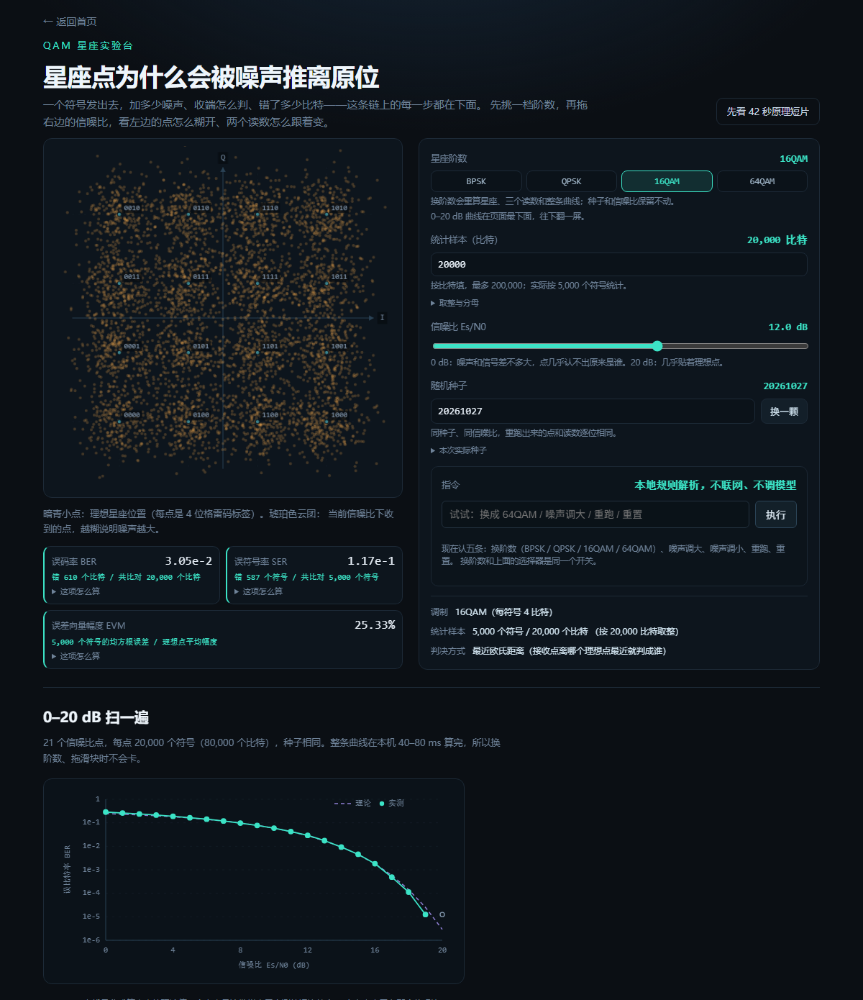
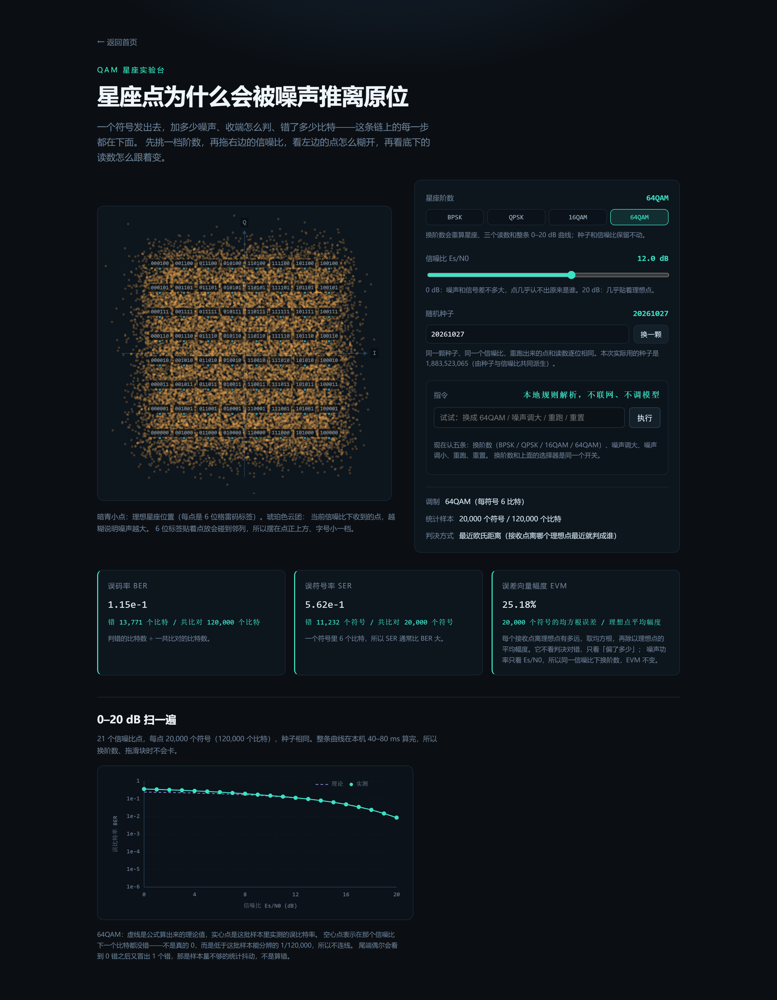
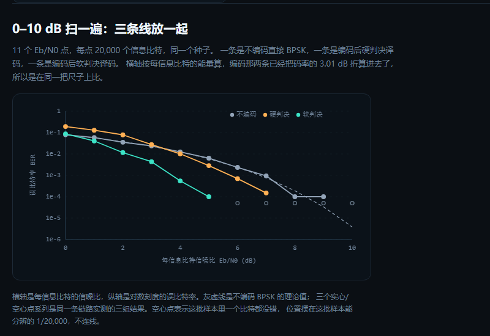

# 作品介绍 · 通信原理交互实验室

本文件对应仓库 tag `R115`。这份介绍是写给评委看的一次性快照，对应的就是这个版本，不跟着仓库往前走；这里写的 405 条测试这类数是文档内容；功能描写按 R115 为准，测试条数这类跟着代码走的数由脚本按当前 `src/core/` 重算。这些数不是抄来的：`npm run check:docs` 每次都会把本文件里的数字用 `src/core/` 的同一套函数重算一遍，对不上就退出码 1，并打印文件名、行号、文档写的值和实际值。在线地址 `https://240000000.github.io/comm-lab/`，仓库 `https://github.com/240000000/comm-lab`，回看这一版用 `git show R115`。

## 一、这个项目是干什么的

通信原理的课本上全是公式：误码率曲线、卷积码的网格图、OFDM 的循环前缀。背下来不难，难的是知道这些符号在波形上到底长什么样——为什么十六个点会散成十六团云，为什么多传三个校验位只能纠一位错，为什么相位差半个符号环路会自己追上去。

这个项目把公式做成三个能拖的网页实验台：QAM 星座与误码率、卷积码与 Viterbi 译码、OFDM 与循环前缀。每页三样东西固定：左边（或上面）一张图，右边一组控件，图下面一排读数。拖动信噪比滑块，点云自己散开、误码率自己跳数、理论曲线和实测点自己分开；改一回参数，所有数字当场重算，页面上没有一个是提前写好的常数。另有第四页「任务模式」，五道题，答完当场判分。

在这三个实验台之上，还有一层「课程视图」：把整门课拆成 13 章，每章一屏，用一条疑问句开头、用一张图和三个读数回答问题，并且每章都留一个「让它失效」的按钮——按下去，参数跳到反例位置，读数变红、结论改口。这一层是本项目与「好看的仿真图」之间最本质的区别，第四节单独讲。

## 二、怎么用

打开首页是四张卡：QAM 星座、卷积码、OFDM、任务模式，下面还有一行「课程视图」的文字入口。新读者建议按这个顺序走：

第一张卡进去，右侧「信噪比 Es/N0」滑块先拖到 0 dB，看十六个点怎么糊成一片云，再拖回 12 dB 看它收拢；读数条在星座下方，第一个数是误码率，带分母，第二个是误符号率，第三个是 EVM；想看整条曲线，往下翻一屏。第二张卡是卷积码：图在左、控件在右，短序列框里可以手改比特，翻一位能纠回来，翻两位会照实写「还有 1 位没纠回来」，页底三条线是不编码、硬判决、软判决。第三张卡是 OFDM：两张图在上（时域波形、频谱），横栏在下（CP 长度、延时、子载波），改 CP 长度能直接看到符号间干扰消失的过程。第四张卡是任务模式：五道题先填答案再点判定，判分是纯函数，不联网。

课程视图那一页是左右分栏：左边 13 章目录树，右边渲染当前章一屏。每屏五段，从上到下依次是一句话疑问句、参数条、主图、读数条（三个数字）、结论卡。参数条右边有两个按钮：「让它失效」和「回到正常」。

任务模式判分的容差口径写在页面上：真值大于 0 的题，误差在 `max(真值×10%, 1e-5)` 以内算对；真值是 0 的题只认 0；要求整数答案的题必须精确相等。之所以不一刀切，是因为真实实验台上的读数本来就不会正好相等。

## 三、现在做到哪一步

三个实验台和课程视图都已经上线，13 章全部可点，没有「未实现」的占位。下面这些数都是当场重算的：

QAM 页四档可切（BPSK、QPSK、16QAM、64QAM），默认统计 20,000 个比特。12 dB 时，16QAM 的误码率 3.05e-2，旁注 610 / 20,000；64QAM 是 1.16e-1；BPSK 和 QPSK 在这台机器上都是 0 个比特错——所以读数不写「1e-5」这种假精度，写「0 / 20,000」，画空心圈，并注明最小可分辨是 1/20,000。四档的 EVM 实测在 25.18% 到 25.35% 之间——同一个 Es/N0 下理论值与阶数无关，这点差别来自有限样本的估计波动，这一点在页面上写了原因。

卷积码页约束长度 3、码率 1/2、生成多项式 7 和 5，硬判决与软判决是两套独立实现。卷积码的网格搜索给出自由距离 5，能纠 2 位。Eb/N0 = 4 dB 那一点，20,000 比特里硬判决错 203 个、软判决错 11 个，不编码要错 251 个——软判决比硬判决少错近二十倍，这个差距是页底三条线的主要看点。

OFDM 页是 64 个子载波、QPSK 调制、一主径一延时径，CP 长度 0–24 可调，统计 200 个符号。信道估计、均衡、频偏这三件事没做，页面上明写了「没做」，没拿「简化模型」四个字含糊过去。

课程视图 13 章，每章一屏五段，参数个数 2 到 4 个。任务模式五道题，覆盖数值、现象、能力、概念、选型五类。测试 405 条，分布在 38 个文件里。本机跑一遍：单次 20,000 符号 6.8 ms，16QAM 一条 21 点曲线 82.0 ms，卷积 11 点 404.1 ms，OFDM 200 符号 18.3 ms（同一台机器上会抖，脚本每次现算）。

## 四、课程视图：13 章，一屏一段，每章都要能调出一个反例

课程视图是本项目最新的一层，也是最难讲清的一层。它的判据只有一句：**能调出一个反例，才算仿真。**

一屏五段的分工是这样的：第一段是一句疑问句，把这一章要回答的问题写成问句（第 13 章是「相位差着半个符号，环路凭什么自己追上去？」）；第二段是参数条，2 到 4 个控件；第三段是主图，full 宽一张；第四段是读数条，固定三个数字；第五段是结论卡，用一两句话把这一屏的结论说死。

关键在第四段和第五段有个「让它失效」按钮。按下去，参数不随机跳，而是跳到**预设的一组参数值**——预设本身只是一组数，不是「特判文字」，所以反例是真的算出来的，不是写死的。同时读数里至少一个数字变红，结论卡改口。再按「回到正常」，参数回到默认，读数与结论一起回来。

举个具体的：第 13 章是一阶数字锁相环。默认增益 K = 0.60 时，60 步后剩余相位误差读数是「0.000 / 0.000」，收敛步数 7 步，环路锁定写「锁住」。点「让它失效」，K 跳到 2.40，同一个环路的误差乘数从 1−K = 0.40 变成 −1.40，绝对值超过 1，误差不再收敛而是每步翻倍振荡：读数变成「1.027 / 0.000」，收敛步数「—」，锁定一栏改口写「没锁住」，结论卡也改成「|1−K| = 1.40 > 1，60 步走完根本没进 ±0.02 的判定带」。

这一条判据为什么重要：只要作者愿意，任何仿真都能画出漂亮的曲线，也都能在结论里写一句「可见环路能够锁定」。但「能不能把它调坏」是没法糊弄的——要么你的代码真的会算崩，要么不会。13 章各自的反例阈值都落在实现里（第 2 章对偶偏差超过 1e-3 判失败、第 5 章调制度超过 1 判包络失真、第 10 章抽样率低于两倍最高频率判混叠），`tests/course.test.ts` 每章跑一次正例、一次反例，断言读数确实变了、结论确实改口了。

这一层的入口在书架：书架上除了内置书，还能导入自己的教材。导入后打开任意一章，左边还是那一屏实验，右边就是课本原文——默认 6:4 分栏，`pdf.js` 按页宽高换算出 viewport 单页渲染，翻页前把上一页没画完的 `renderTask` 取消，连点也只画最后一页；栏可以一键收起，收起后和没有原件时完全一样。

数字版的书直接读文字层：逐页 `getTextContent` 按 `transform` 的纵坐标聚行，按书签或者「第 N 章 / N.N」切节，再拿 13 个实验各自那二十来个概念词打分，告诉你「这一节最像哪个实验」，并把命中的词摆出来。扫描版没有文字层，就只能认目录页、再对每章首页做 OCR：真书 484 页、296 条书签，考下来 13 章 13 中；强制无书签那条路径 2.0 秒认出 13 章，但第 4 章那行 OCR 把「4.1」丢了，得在确认表里手填——十二中一填，不是十三全自动。原件还会被记下页数与首页前 80 字，换了一本书就对不上，界面拒绝渲染，只给一句提示和「清除原件」。OCR 起不来时只按标题匹配，界面上直说「仅依据目录标题」；tesseract 与中文语言包全在本地，只在导入扫描件时按需取，主包不含。

## 五、亮点

**读数带分母。** 误码率不写一个孤立的小数，写「2,331 / 80,000」，20 dB 那种一个比特都没错的情况写「这次没出错 0 / 80,000」并画空心圈。这样做的好处是读者一眼知道这个数有多可信：分母只有 20,000 的时候，任何小于 5e-5 的误码率都没有统计意义。

**同种子可复现。** 三个实验台用同一个种子派生各自的随机流，种子显示在界面上。同一个种子重跑，逐位相同；换个种子，数字会动，但统计上应该在同一个量级。这一条是可以被外部检验的。

**刻意保留的难看地方。** 卷积码页在 0–2 dB 那一段，硬判决的误码率比不编码还高。这不是 bug：码率 1/2 让每个码符号只剩一半能量（Es/N0 = Eb/N0 − 3.01 dB），硬判决又把接收幅度信息丢掉了。页面没有把这段藏起来，反而标了出来——评审如果只看到「编码总是更好」的图，那多半是图被修过。

**课程视图的失效按钮。** 见第四节。这是全项目里最不像「作品包装」、最像「工程约束」的一处。

**三条短视频。** 三个实验台各挂一段几十秒的原理短片，画面是用同一套算法现算逐帧画的，不是录屏；旁白是本机语音合成；离线可放，不依赖网络。

## 六、AI 是怎么参与进来的

这个项目从空仓库写起，每一轮对话的原文都存在 `docs/dialogues/`，一轮一次提交、一次打 tag。AI 在这里不是「帮我写个页面」，而是被一整套判据和存档约束住：

**判据先落盘，实现后写。** 每个功能开写之前先把判据写成 `docs/criteria/` 下的一个文件，写清范围、判据、口径、验收，然后再动代码，写完逐条对照。不达标就改实现，不改判据。

**数字不许手抄。** 文档里的测试条数、误码率、EVM、自由距离、子载波数、耗时，全部由 `scripts/check-docs.mjs` 从 `src/core/` 重算后比对，CI 里这一步跑在构建之前，对不上就不部署。

**存档必须抄原话。** 早期有一轮，存档里被抓出四句话不是用户原话。从此立的规矩是：引用一律复制粘贴，拿不到就说「原文缺失」，事后不许 amend，只能单开一个 fix 提交——因为改历史等于把证据改掉。

**判据被实测推翻就改判据。** 第一轮的判据是「还没有测试文件时 `npm test` 会失败」，实测下来 0 个测试时退出码是 0，判据是空的，于是改成「测试数不少于 21 条、fail 为 0」。这一条现在还在 CI 里。

这些机制不是给评审看的装饰。第 2 章对偶偏差 8.75e-1、第 11 章 e = 2 时正确率 0.0%（21 个模式全误纠）、第 13 章 K = 2.40 时残差停在 1.027，这些数都不是我算出来写进去的，是脚本跑出来、页面显示、文档被脚本校验过的同一个数。

## 七、关键技术

纯前端：Vite + React + TypeScript，无后端、无数据库、运行时不调用任何模型接口、不需要密钥，构建产物是静态文件，托管在 GitHub Pages 上。

算法全部自写，不引通信库。星座映射与格雷码、AWGN 加噪与最近距离判决、理论误码率曲线、卷积码网格与编码、硬软两套 Viterbi、自由距离搜索，都在 `src/core/` 里，是纯函数，能被测试直接调用，也能被文档校验脚本直接调用——同一个函数出三个地方的数。

随机数用 mulberry32，正态噪声用 Box–Muller 从均匀分布变换出来，种子从用户可见的种子派生，所以「同种子重跑逐位相同」是可以被验证的，不是口头承诺。

硬判决与软判决的差别落在分支度量上：硬判决先按 0 门限把接收符号切成比特，再比汉明距离；软判决直接用接收幅度到 ±1 理想点的平方距离当分支度量，幅度信息没有被丢掉。这也是 4 dB 那一点 203 比 11 的来由。

数字口径统一：所有统计都报「错误数 / 总数」，不报裸的小数；理论值与实测值并排画，不把两条线画成一条。

## 八、截图

图注：QAM 页 16QAM、12 dB。点云是十六团，读数条带分母 610 / 20,000，下方曲线是理论与实测并排。

图注：同样是 12 dB，切到 64QAM 之后点云更密，误码率随之升高——同样的 Es/N0 下，阶数越高越吃信噪比。

图注：卷积码页 0–10 dB 三条线。0–2 dB 那一段硬判决高于不编码，是码率 1/2 与硬判决丢幅度共同造成的，不是画错。

## 九、两句实话

第一，这个项目没有发表过论文，也没有获过奖，它是一个课程配套工具，价值在于把课本上的公式变成能拖的东西，不在于提出了新算法。

第二，代码从空仓库一行一行写起，没有用任何现成的通信库，只参考了课本上的公式；凡是页面上出现的数字，都有一条命令能在本机重跑出来。

（本文件由 `npm run check:docs` 校验：文件里的 tag 数、测试条数、课程视图章数、四档误码率与 EVM、自由距离与纠错能力、子载波数、锁相环反例读数、单次仿真耗时，都会被重新计算并与本文件比对。）